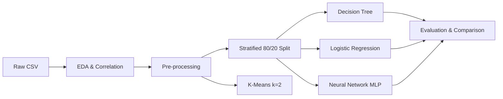

# 📦 E-Commerce Shipment Delay Prediction Using Machine Learning

Predicting whether an e-commerce order will reach the customer on time, using order, product, and delivery-related features. Three supervised classifiers (Decision Tree, Logistic Regression, Neural Network) are compared, and K-Means clustering is used to explore the structure of the data.
---

## 🚩 The Problem

E-commerce depends on delivering orders when customers expect them. When shipments arrive late:

- **Customer trust drops**, which hurts ratings and repeat purchases.
- **Operational costs rise** through extra support calls, complaints, and refunds.
- **Logistics teams react too late**, because delays are usually discovered after the promised date has already passed.

Platforms ship thousands of orders with different weights, discounts, warehouses, and shipping modes. It is hard to tell, by inspection, which orders are at risk and which factors drive the delays.

**Core question:** *Given the details of an order, can we predict whether it will reach the customer on time?*

---

## 💡 My Solution

I framed the problem as a **binary classification task** on an e-commerce shipping dataset (10,999 orders, 11 input features) and built an end-to-end machine learning pipeline:

1. **Explore** the data: distributions, correlations, and class balance.
2. **Clean and prepare** it: drop the non-informative `ID`, encode categorical features (ordinal, label, and one-hot), and standardize numeric features.
3. **Split** it with a stratified 80/20 train/test split to keep the class ratio equal in both sets.
4. **Train and compare three models:**
   - Decision Tree (non-linear baseline)
   - Logistic Regression (linear baseline)
   - Neural Network, an MLP with layers (100, 50)
5. **Evaluate** each with accuracy, precision, recall, F1, AUC, confusion matrices, and ROC curves.
6. **Explore structure** with K-Means clustering (k = 2) to see what naturally separates the orders.

---

## 🎯 Impact

**What the results show**

- The models predict delays **better than chance** (AUC up to **0.73**, accuracy about **64%**), and the best choice depends on the business goal:
  - **Neural Network:** recall of **0.77** and the highest F1 and AUC, so it catches the most delayed shipments (it also raises more false alarms).
  - **Logistic Regression:** highest accuracy (**0.64**) and precision (**0.71**), so it is the most reliable when a flag is raised.
- **`Discount_offered`** and **`Weight_in_gms`** are the strongest signals of delay, so these are the first places a logistics team should look.
- `Gender`, `Customer_care_calls`, and `Mode_of_Shipment` add almost no predictive value, so they can be deprioritized in future data collection.

**How this could be used**

- Flag high-risk orders **before** dispatch so they can be prioritized, rerouted, or given realistic delivery estimates.
- Guide data collection: the ~64% ceiling shows that key factors are missing, such as **distance to destination**, carrier performance, and warehouse load.

**Honest scope:** this is an academic proof of concept on a single dataset. It is not production-ready, and about 64% accuracy means it should support human decisions, not replace them. See the Limitations section below.


## 📌 Overview

Late deliveries reduce customer trust and raise operational costs. This project treats shipment delay as a **binary classification** problem and asks:

- Which features are most associated with late delivery?
- How do a simple model (Logistic Regression), a non-linear model (Decision Tree), and a neural network (MLP) compare?
- How much can the available features actually predict?

---

## 📊 Dataset

| Property | Value |
| --- | --- |
| File | `E-commerce Shipping Dataset.csv` |
| Instances | 10,999 |
| Attributes | 12 (11 inputs + 1 target) |
| Missing values | None |
| Task | Binary classification |

**Input features**

| Feature | Type | Description |
| --- | --- | --- |
| `ID` | Numeric | Row identifier (dropped) |
| `Warehouse_block` | Categorical | Warehouse block (A–F) |
| `Mode_of_Shipment` | Categorical | Flight / Ship / Road |
| `Customer_care_calls` | Numeric | Number of customer care calls made |
| `Customer_rating` | Numeric | Rating from 1 to 5 |
| `Cost_of_the_Product` | Numeric | Product cost |
| `Prior_purchases` | Numeric | Number of previous purchases |
| `Product_importance` | Categorical | Low / Medium / High |
| `Gender` | Categorical | F / M |
| `Discount_offered` | Numeric | Discount on the product |
| `Weight_in_gms` | Numeric | Product weight in grams |

**Target:** `Reached.on.Time_Y.N` (1 = not delivered on time, 0 = delivered on time, as defined by the dataset).

Class distribution: about **59.7%** class 1 and **40.3%** class 0 (moderately imbalanced).

> 📥 Download the dataset and place the CSV in the project folder (add your dataset link here).

---

## 🔄 Pipeline



### 1. Exploratory Data Analysis
- Summary statistics, variance, skewness, boxplots, and histograms
- Correlation matrix and heatmaps
- Class-balance analysis

**Key correlations with the target**

| Feature | Correlation |
| --- | --- |
| `Discount_offered` | +0.40 |
| `Weight_in_gms` | −0.27 |
| `Customer_care_calls` | −0.07 |
| `Cost_of_the_Product` | −0.07 |
| `Prior_purchases` | −0.06 |
| `Customer_rating` | +0.01 |

### 2. Pre-processing

| Issue | Fix |
| --- | --- |
| Irrelevant identifier (`ID`) | Dropped |
| `Product_importance` (ordered) | Ordinal mapping: low=0, medium=1, high=2 |
| `Gender` (2 categories) | Label encoding |
| `Warehouse_block`, `Mode_of_Shipment` (unordered) | One-hot encoding (`drop_first=True`) |
| Different feature scales | `StandardScaler` on numeric columns (z-score) |

After encoding, the model input has **14 features**.

### 3. Train / Test Split
Stratified random split, **80% train (8,799) / 20% test (2,200)**, `random_state=42`, preserving the class ratio in both sets.

### 4. Models

| Model | Configuration |
| --- | --- |
| Decision Tree | `DecisionTreeClassifier(random_state=42)` |
| Logistic Regression | `LogisticRegression(max_iter=1000, random_state=42)` |
| Neural Network | `MLPClassifier(hidden_layer_sizes=(100, 50), max_iter=500, random_state=42)` |
| K-Means (unsupervised) | `KMeans(n_clusters=2, n_init=10, random_state=42)` |

---

## 📈 Results

Evaluated on the 20% held-out test set (2,200 samples).

| Model | Accuracy | Precision | Recall | F1 | AUC |
| --- | --- | --- | --- | --- | --- |
| Decision Tree | 0.6350 | 0.6923 | 0.6992 | 0.6957 | 0.6196 |
| **Logistic Regression** | **0.6400** | **0.7086** | 0.6740 | 0.6909 | 0.7174 |
| Neural Network (MLP) | 0.6305 | 0.6643 | **0.7700** | **0.7132** | **0.7266** |

**Confusion matrices** (rows = actual, columns = predicted; order 0, 1)

| Model | TN | FP | FN | TP |
| --- | --- | --- | --- | --- |
| Decision Tree | 479 | 408 | 395 | 918 |
| Logistic Regression | 523 | 364 | 428 | 885 |
| Neural Network | 376 | 511 | 302 | 1011 |

**Takeaways**
- All three models plateau at about **63–64% accuracy**, so the available features have limited predictive power.
- **Logistic Regression** has the highest accuracy and precision; the **Neural Network** has the best recall, F1, and AUC (it catches the most class-1 cases but also raises the most false alarms); the **Decision Tree** has the lowest AUC.
- Which model is "best" depends on the goal: pick by recall/F1 to catch as many delays as possible, or by precision/accuracy to limit false alarms.
- **`Discount_offered`** and **`Weight_in_gms`** are the most informative features. K-Means clusters were mostly separated along weight.
- `Gender`, `Customer_care_calls`, and `Mode_of_Shipment` carry very little signal.

### Metrics used

```
Accuracy  = (TP + TN) / (TP + TN + FP + FN)
Precision = TP / (TP + FP)
Recall    = TP / (TP + FN)
F1        = 2 · Precision · Recall / (Precision + Recall)
AUC       = area under the ROC curve (TPR vs FPR across thresholds)
```

---

## ⚠️ Limitations

- No geographic data (for example, distance to destination), a key factor in delivery time.
- No operational data such as warehouse load or courier performance.
- Single train/test split; results vary slightly with the split, and no cross-validation or hyperparameter search was applied.
- Moderate class imbalance was handled by stratification only (no resampling or class weights).

## 🚀 Future Work
- Cross-validation and hyperparameter tuning (tree depth, MLP size, regularization)
- Ensemble models (Random Forest, Gradient Boosting, XGBoost)
- Class weighting or SMOTE, plus threshold tuning for recall-focused use
- Fit the scaler on the training set only, inside a `Pipeline`, to avoid leakage
- Feature importance / SHAP analysis
- Add distance, carrier, and warehouse-capacity features if available

---

## 🛠️ Tech Stack
Python · pandas · NumPy · scikit-learn · Matplotlib · Seaborn · Google Colab / Jupyter

## 📁 Repository Structure

```
.
├── E-Commerce_Shipment_Delay_Prediction_Using_Machine_Learning_Project.ipynb   # Full code & outputs
├── E-Commerce_Shipment_Delay_Prediction_Using_Machine_Learning_Report.pdf      # Project report
├── E-commerce Shipping Dataset.csv                                             # (add dataset here)
└── README.md
```

## ▶️ How to Run

**Option A: Google Colab (as originally written)**
1. Upload the dataset to Google Drive.
2. Open the notebook in Colab and set the CSV path in the data-loading cell.
3. Run all cells.

**Option B: Locally**
```bash
git clone https://github.com/<your-username>/<repo-name>.git
cd <repo-name>
pip install pandas numpy matplotlib seaborn scikit-learn jupyter
jupyter notebook
```
In the notebook, remove the Google Drive mount cell and load the data directly:
```python
df = pd.read_csv("E-commerce Shipping Dataset.csv")
```

---

## 👥 Authors
- **Sayed Arifin Ahmed Alak**
- **Farhan Mahmud**

Submitted to: Rafeed Rahman, Maazin Munawar (CSE422, BRAC University)
